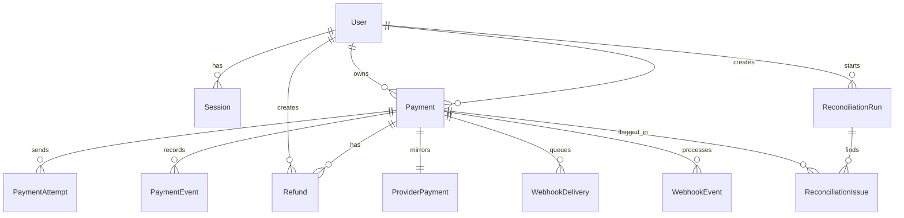

# Domain Model



## User
- Schema/model file: `prisma/schema.prisma` model `User`
- Primary service owner: `src/services/authService.ts` via `login()` and `logout()`
- Notes: Users are also the ownership boundary for payments in `src/services/paymentAccessPolicy.ts`.

## Session
- Schema/model file: `prisma/schema.prisma` model `Session`
- Primary service owner: `src/services/authService.ts` via `login()`
- Notes: `src/lib/auth/session.ts` resolves cookie tokens back to session rows before any route is trusted.

## IdempotencyRecord
- Schema/model file: `prisma/schema.prisma` model `IdempotencyRecord`
- Primary service owner: `src/services/paymentService.ts` via `createPaymentWithIdempotency()`
- Notes: This is the durable replay contract. The payment row is not the idempotency mechanism.

## Payment
- Schema/model file: `prisma/schema.prisma` model `Payment`
- Primary service owner: `src/services/paymentService.ts` via `createPaymentWithIdempotency()`
- Notes: Local status is intentionally allowed to drift behind provider truth until `src/services/webhookService.ts` corrects it. (Correction: `src/services/reconciliationService.ts` does **not** correct status. It only writes `ReconciliationIssue` rows and `RECONCILIATION_FLAGGED` events — there is no `transitionPaymentStatus()` call anywhere in that file. A payment created with `PARTIAL_SUCCESS` stays `PENDING` forever unless someone hand-crafts a webhook.)

## PaymentAttempt
- Schema/model file: `prisma/schema.prisma` model `PaymentAttempt`
- Primary service owner: `src/services/providerSimulatorService.ts` via `dispatchPaymentToProvider()`
- Notes: Attempts preserve retry/debug history instead of collapsing all provider communication into the payment row.

## ProviderPayment
- Schema/model file: `prisma/schema.prisma` model `ProviderPayment`
- Primary service owner: `src/services/providerSimulatorService.ts` via `dispatchPaymentToProvider()`
- Notes: This is the simulated external source of truth that reconciliation compares against.

## WebhookDelivery
- Schema/model file: `prisma/schema.prisma` model `WebhookDelivery`
- Primary service owner: `src/services/providerSimulatorService.ts` via `dispatchPaymentToProvider()` and `deliverPendingWebhooks()`
- Notes: Outbound delivery tracking exists so "provider succeeded but our local system never heard about it" is a first-class state.

## WebhookEvent
- Schema/model file: `prisma/schema.prisma` model `WebhookEvent`
- Primary service owner: `src/services/webhookService.ts` via `processProviderWebhook()`
- Notes: Inbound processing is idempotent on `providerEventId`, not just on payment id. (Precision: the dedupe is a read at `src/services/webhookService.ts:30-37` followed by an insert inside a later transaction. Sequential duplicates are skipped; *concurrent* duplicates both pass the read and the loser hits the `@unique` on `providerEventId` (`prisma/schema.prisma:216`) as an uncaught `P2002`, which surfaces as a 500 / a `FAILED` delivery. The constraint prevents double application; the code does not turn the collision into a clean "duplicate" answer.)

## PaymentEvent
- Schema/model file: `prisma/schema.prisma` model `PaymentEvent`
- Primary service owner: multiple services append here, but `src/repositories/paymentEventRepository.ts` is the single write boundary
- Notes: This is the transaction history requested in the brief. Operators read this trail in `src/components/payments/PaymentDetailsCard.tsx`.

## Refund
- Schema/model file: `prisma/schema.prisma` model `Refund`
- Primary service owner: `src/services/refundService.ts` via `createRefundForPayment()`
- Notes: Full refunds transition the payment to `REFUNDED`; partial refunds leave the payment in `SUCCEEDED`.

## ReconciliationRun
- Schema/model file: `prisma/schema.prisma` model `ReconciliationRun`
- Primary service owner: `src/services/reconciliationService.ts` via `runReconciliation()`
- Notes: Reconciliation runs are historical records, not a single mutable report.

## ReconciliationIssue
- Schema/model file: `prisma/schema.prisma` model `ReconciliationIssue`
- Primary service owner: `src/services/reconciliationService.ts` via `runReconciliation()`
- Notes: Missing provider rows, missing local rows, missing webhook deliveries, and status mismatches are stored explicitly so operators can reason about eventual consistency failures.

---

## Constraints that carry the correctness story

The prose above says what each model is *for*. This table says which schema line actually enforces what, because in this repo several guarantees live only in the database.

| Guarantee | Enforced by | Line | Notes |
|---|---|---|---|
| One logical create per idempotency key | `@@unique([route, key])` on `IdempotencyRecord` | `prisma/schema.prisma:135` | The real guard; the service-level pre-check at `paymentService.ts:68` is an optimization. Not scoped per user. |
| One provider mirror per payment | `paymentId String @unique` on `ProviderPayment` | `schema.prisma:182` | Makes the `ProviderPayment` side of the ER diagram genuinely one-to-one. |
| A provider payment id maps to exactly one local payment | `providerPaymentId @unique` on `Payment`, `externalPaymentId @unique` on `ProviderPayment` | `schema.prisma:146`, `:183` | Webhook lookup (`findProviderPaymentByExternalId`) depends on it. |
| An inbound event is applied once | `providerEventId @unique` on `WebhookEvent` | `schema.prisma:216` | Concurrency guard of last resort for webhooks. |
| An outbound event is queued once | `providerEventId @unique` on `WebhookDelivery` | `schema.prisma:198` | |
| Refund total ≤ captured amount | **nothing in the schema** | `schema.prisma:244-258` | Only the service check at `refundService.ts:34`, which is not concurrency-safe (see `request-lifecycle.md` L2). |
| Payment status moves only along legal edges | **nothing in the schema** | `schema.prisma:143` | Only `assertAllowedPaymentTransition()`, which `refundService.ts:68-75` does not call. |
| Session tokens unique | `token @unique` | `schema.prisma:112` | |

## Fields and enum values that no code path writes or reads

These are useful to know because they look like features when you read the schema, and they are not.

- `IdempotencyStatus.CONFLICT` (`schema.prisma:27`) — the only writer is `markIdempotencyConflict()` (`src/repositories/idempotencyRepository.ts:64-72`), which nothing calls. Payload mismatches are reported as `409` without touching the record.
- `IdempotencyRecord.lockedAt` (`schema.prisma:131`) — set at `idempotencyRepository.ts:36`, cleared at `:59` and `:69`, never read. There is no stale-lock recovery because, as `request-lifecycle.md` Trace A explains, no other transaction can observe an `IN_PROGRESS` row.
- `WebhookDelivery.nextAttemptAt` (`schema.prisma:205`) — written on failure (`webhookRepository.ts:62`), never queried. Failed deliveries are never retried.
- `PaymentEventType.REFUND_FAILED` and `RECONCILIATION_CLEARED` (`schema.prisma:52`, `:54`) — never emitted; refunds always succeed instantly (`refundService.ts:63`) and issues are never cleared.
- `ReconciliationIssueStatus.RESOLVED` / `IGNORED` and `ReconciliationIssue.resolvedAt` (`schema.prisma:83-84`, `:285`) — no route or service changes an issue's status. Each reconciliation run re-flags the same still-broken payment, so issues accumulate (one per payment per run).
- `RefundStatus.PENDING` exists in practice only inside the refund transaction (`refundService.ts:37` then `:63`); no committed refund is ever `PENDING`.
- `WebhookProcessingStatus.REJECTED` and `WebhookEvent.processingError` — written at `webhookService.ts:125` but rolled back by the re-throw on the next line (see `request-lifecycle.md` L3).
- `reconciliationRunSchema` (`src/lib/validation/reconciliationSchemas.ts:13-15`) — defined, never imported.

## Which rows does each simulation mode produce?

`resolveProviderSimulation()` (`src/services/providerSimulatorService.ts:24-52`) decides the shape. All rows are written inside the create transaction (`paymentService.ts:87`).

| `simulationMode` | `ProviderPayment.status` | `ProviderDecision` | `WebhookDelivery` queued? | Local `Payment.status` right after create | What reconciliation reports before any delivery |
|---|---|---|---|---|---|
| `SUCCEED` | `SUCCEEDED` | `SUCCEED` | yes | `PENDING` | `STATUS_MISMATCH` (delivery exists) |
| `FAIL` | `FAILED` | `FAIL` | yes | `PENDING` | `STATUS_MISMATCH` |
| `PARTIAL_SUCCESS` | `SUCCEEDED` | `PARTIAL_SUCCESS` | **no** | `PENDING` | `MISSING_WEBHOOK_DELIVERY` |
| `NETWORK_UNKNOWN` | `SUCCEEDED` | `NETWORK_UNKNOWN` | yes | `PENDING` | `STATUS_MISMATCH` |

Two observations from the table:

- `NETWORK_UNKNOWN` differs from `SUCCEED` only in the `transport: "AMBIGUOUS"` string stored on `PaymentAttempt.responsePayload` (`providerSimulatorService.ts:84`). No code reads that string, so the "ambiguous network" scenario is labelled but not modelled — there is no retry, no lookup-by-reference, no second attempt.
- `MISSING_PROVIDER_PAYMENT` and `MISSING_LOCAL_PAYMENT` (`reconciliationService.ts:42-55`, `:85-100`) cannot arise from the app's own write paths: the provider mirror is created in the same transaction as the payment, and `ProviderPayment.paymentId` is a foreign key with `onDelete: Cascade` (`schema.prisma:191`), so a provider row without a local row cannot exist. Those branches only fire if someone edits the database by hand.

## Status lifecycles as implemented

`Payment.status` (guarded only on the webhook path):

```
PENDING --webhook SUCCEEDED--> SUCCEEDED --refund sum == amount--> REFUNDED
   |                               ^ (webhook REFUNDED is also accepted here, with no Refund row)
   +----webhook FAILED-----> FAILED
```

The allowed-edge table lives at `src/lib/domain/paymentStateMachine.ts:10-15`; same-state writes are a no-op (line 21-23). A scratch test enumerated all 16 `(from, to)` pairs and confirmed exactly seven pass: the four self-loops plus `PENDING→SUCCEEDED`, `PENDING→FAILED`, `SUCCEEDED→REFUNDED` (check C5 in `docs/learning/testing-rationale.md`).

`ProviderPayment.status` has **no** transition guard: `updateProviderPaymentStatus()` (`src/repositories/providerRepository.ts:40-55`) writes whatever the webhook says, before the local guard runs. A late `PROCESSING` webhook for a payment that is already `SUCCEEDED` locally is rejected by the local guard — but because the transaction then rolls back, the provider mirror keeps its old value too. That is the only thing keeping the mirror consistent in that case.

## Exercises

1. **Goal:** connect a guarantee to its constraint. **Check:** delete (mentally) `@@unique([route, key])` at `schema.prisma:135`. Which line in `paymentService.ts` stops being reachable, and what happens to two concurrent requests with the same key?
2. **Goal:** spot dead schema. **Check:** pick any enum value in `schema.prisma` and grep `src/` for it. Which of `PaymentEventType`'s nine values are actually emitted? (Seven: everything except `REFUND_FAILED` and `RECONCILIATION_CLEARED`.)
3. **Goal:** predict reconciliation output. **Check:** create one payment in each simulation mode, deliver nothing, run reconciliation. Using the table above, predict the four issue types before you look at the UI.
